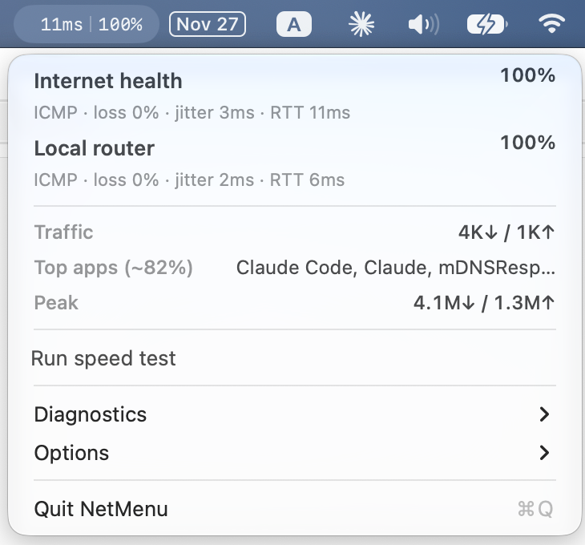

# NetMenu — Internet health in your Mac’s menu bar

[](https://github.com/SokolskyNikita/mac-net-monitor-toolbar/releases/latest)
[](LICENSE)


Spot packet loss, latency spikes, and internet outages as they happen. NetMenu is a free, open-source macOS network monitor with live bandwidth, per-app traffic, and speed tests—built for unreliable Wi-Fi in hotels, airports, planes, and on phone hotspots.



**[Download NetMenu for macOS](https://github.com/SokolskyNikita/mac-net-monitor-toolbar/releases/latest)** · [Install with Homebrew](#homebrew)

- **See when your connection struggles.** Track latency, packet loss, jitter, and internet health without opening a terminal.
- **Check that the internet actually works.** NetMenu checks website access even when ping succeeds and filters suspected local replies from captive portals and in-flight proxies.
- **Find what’s using your bandwidth.** See live upload and download rates, identify the top bandwidth apps, and run a speed test from the menu bar.

No accounts or analytics. Monitoring history and app-usage details stay on your Mac.

## Install

Requires macOS 14 (Sonoma) or later on Apple silicon or Intel.

### Homebrew

With [Homebrew](https://brew.sh) installed, run:

```bash
brew tap SokolskyNikita/netmenu https://github.com/SokolskyNikita/mac-net-monitor-toolbar
brew install --cask sokolskynikita/netmenu/netmenu
```

Then open **NetMenu** from Applications.

### Manual download

Download `NetMenu-<version>.zip` from the [latest release](https://github.com/SokolskyNikita/mac-net-monitor-toolbar/releases/latest), unzip it and move `NetMenu.app` to `/Applications`.

### First launch

Releases aren't currently notarized by Apple, so macOS blocks NetMenu the first time you open it, and again after every update. To allow it, try to open the app once, then click **Open Anyway** in **System Settings → Privacy & Security**. Or run:

```bash
xattr -dr com.apple.quarantine /Applications/NetMenu.app
```

macOS may also ask for two optional permissions:

| Permission | Used only for | If denied |
| --- | --- | --- |
| Location | Reading the Wi‑Fi network name and access point | The network shows under a generic label such as Wi-Fi |
| Local Network (macOS 15+) | Checking your router’s health and latency | Local router health may be unavailable |

## Getting started

The menu bar shows latency and connection health, such as `9ms │ 100%`. Click it for router health, bandwidth usage, top apps, and **Run speed test**.

## Update or uninstall

```bash
brew update && brew upgrade --cask netmenu      # update
brew uninstall --cask netmenu                   # uninstall
rm -rf ~/Library/Application\ Support/NetMenu   # optional: delete stats history
rm -rf ~/Library/Logs/NetMenu                   # optional: delete diagnostic logs
```

After an update:

1. Allow the new version to open, as in [First launch](#first-launch).
2. Quit NetMenu from its menu and open it again. Until then the menu bar keeps running the previous version.

Without Homebrew, update by replacing `/Applications/NetMenu.app` with the app from the latest release, and uninstall by moving it to the Trash. Uninstalling keeps your history and logs unless you run the two `rm` commands.

## Documentation

- [User guide](docs/USER-GUIDE.md): reading the menu, speed tests, and your data
- [How it works](docs/HOW-IT-WORKS.md): probes, scoring, and measurement details
- [Logs](docs/LOGS.md): local history and troubleshooting
- [Development](docs/DEVELOPMENT.md) · [Architecture](docs/ARCHITECTURE.md) · [Releasing](docs/RELEASING.md)

## License

NetMenu is released under the [MIT License](LICENSE).
