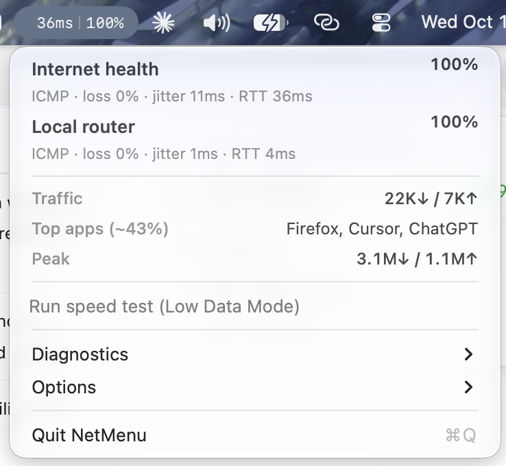

# NetMenu — Internet health in your Mac’s menu bar

[](https://github.com/SokolskyNikita/mac-net-monitor-toolbar/releases/latest)
[](LICENSE)


Spot packet loss, latency spikes, and internet outages as they happen. NetMenu is a free, open-source macOS network monitor with live bandwidth, per-app traffic, and speed tests—built for unreliable Wi-Fi in hotels, airports, planes, and on phone hotspots.



**[Download NetMenu for macOS](https://github.com/SokolskyNikita/mac-net-monitor-toolbar/releases/latest)** · [Install with Homebrew](#homebrew)

- **See when your connection struggles.** Track latency, packet loss, jitter, and internet health without opening a terminal.
- **Check that the internet actually works.** NetMenu checks website access even when ping succeeds and filters suspected local replies from captive portals and in-flight proxies.
- **Find what’s using your bandwidth.** See live upload and download rates, identify the top bandwidth apps, and run a speed test from the menu bar.

No accounts or analytics. Monitoring history and app-usage details stay on your Mac.

## Install

Requires macOS 14 (Sonoma) or later on Apple silicon or Intel.

### Homebrew

With [Homebrew](https://brew.sh) installed, run:

```bash
brew tap SokolskyNikita/netmenu https://github.com/SokolskyNikita/mac-net-monitor-toolbar
brew install --cask sokolskynikita/netmenu/netmenu
```

Then open **NetMenu** from Applications.

### Manual download

Download `NetMenu-<version>.zip` from the [latest release](https://github.com/SokolskyNikita/mac-net-monitor-toolbar/releases/latest), unzip it and move `NetMenu.app` to `/Applications`.

If macOS blocks the first launch, see [Setup and permissions](docs/SETUP.md#first-launch).

## Getting started

The menu bar shows latency and connection health, such as `9ms │ 100%`. Click it for router health, bandwidth usage, top apps, and **Run speed test**.

## Documentation

- [Setup](docs/SETUP.md): first launch, permissions, updates, and uninstalling
- [User guide](docs/USER-GUIDE.md): reading the menu, speed tests, and your data
- [How it works](docs/HOW-IT-WORKS.md): probes, scoring, and measurement details
- [Logs](docs/LOGS.md): local history and troubleshooting
- [Development](docs/DEVELOPMENT.md) · [Architecture](docs/ARCHITECTURE.md) · [Releasing](docs/RELEASING.md)

## License

NetMenu is released under the [MIT License](LICENSE).
